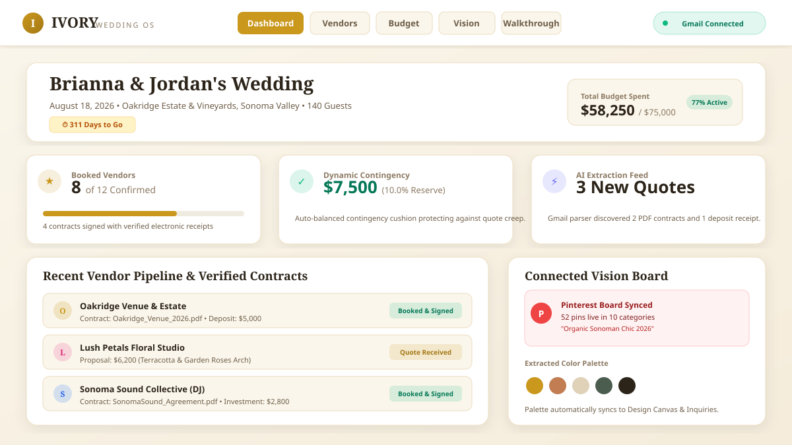
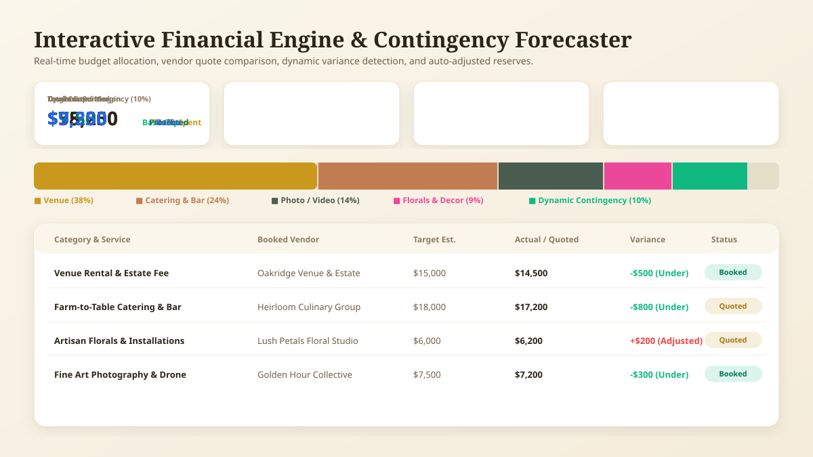
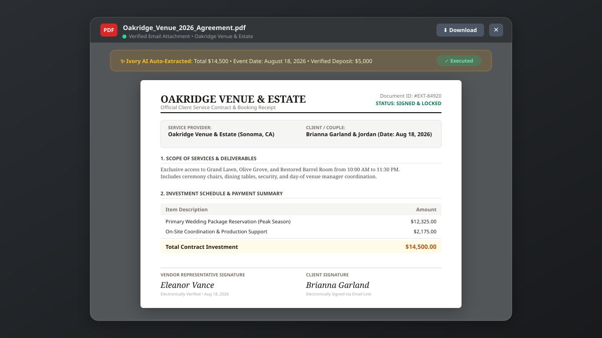
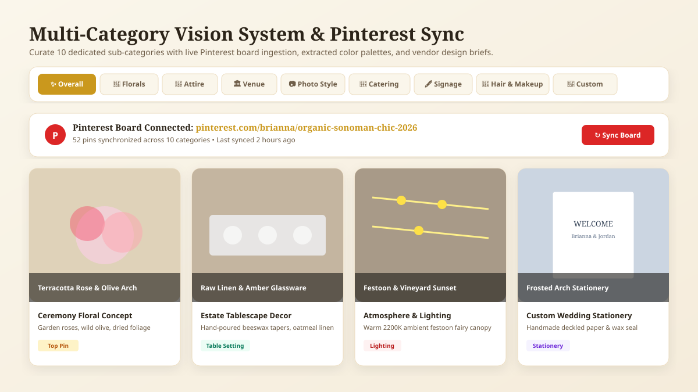
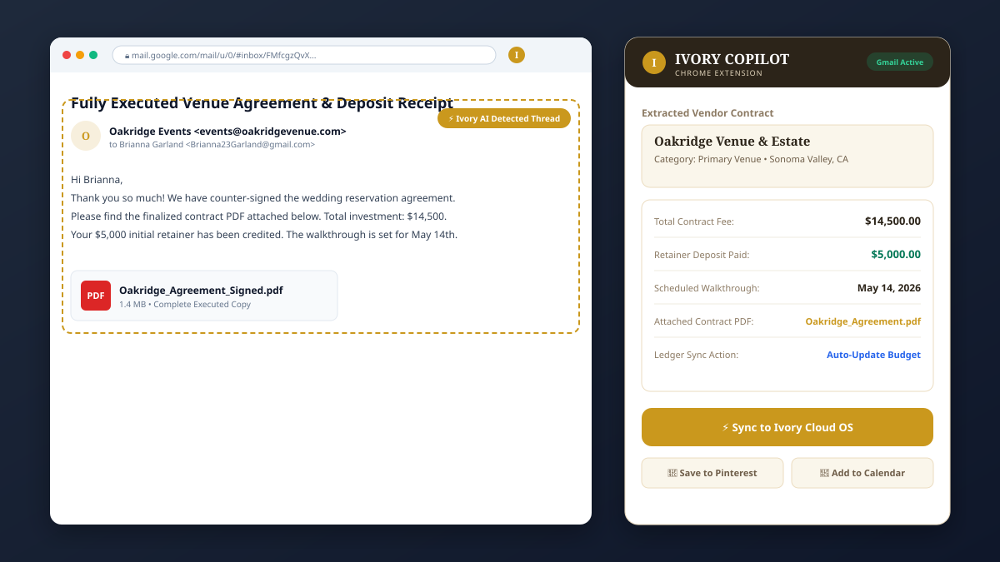

<div align="center">

# 💍 IVORY — Luxury Wedding Intelligence & Financial Operating System

**A calming, editorial AI-powered platform for wedding financial planning, vendor contract intelligence, live Pinterest vision curation, and cross-platform ingestion.**

[](https://react.dev/)
[](https://www.typescriptlang.org/)
[](https://tailwindcss.com/)
[](https://vitejs.dev/)
[](./LICENSE)

---

### [✨ Live Preview Available in AI Studio](https://ais-pre-salycqnsiyzjemu3uviyuq-56800522357.us-east1.run.app) • [📖 Documentation](#table-of-contents) • [🚀 Quick Start](#-getting-started) • [📦 GitHub Export Guide](#-github-export--upload-guide)

</div>

---

## 📸 Visual Walkthrough & Product Design

### 1. Executive Wedding Command Center
> Real-time countdown timer, budget progress gauges, active vendor pipelines, calendar sync alerts, and connected Pinterest vision boards.

<div align="center">
  
</div>

---

### 2. Interactive Budget Forecaster & Contingency Engine
> Real-time categorical allocation sliders, target-vs-actual variance tracking, dynamic 10% protected contingency cushions, and itemized spend ledgers.

<div align="center">
  
</div>

---

### 3. Vendor Contract Intelligence & PDF Viewer
> Official contract attachment viewer rendering letterheads, itemized investment schedules, electronically verified signatures, and AI extraction tags.

<div align="center">
  
</div>

---

### 4. Multi-Category Vision Board with Live Pinterest Sync
> Curate 10 dedicated wedding categories (Attire, Florals, Paper, Lighting, Cake, Music, Photography, etc.) with real-time Pinterest board covers and top pinned visual inspirations.

<div align="center">
  
</div>

---

### 5. Chrome Extension Simulator & Cross-Platform Ingestion
> In-browser simulator illustrating automated contract extraction from Gmail threads, Instagram vendor tags, and Pinterest boards into the centralized ledger.

<div align="center">
  
</div>

---

## 📑 Table of Contents
- [Executive Overview](#-executive-overview)
- [Design Philosophy & Aesthetic Constitution](#-design-philosophy--aesthetic-constitution)
- [Comprehensive Feature Tour](#-comprehensive-feature-tour)
  - [1. Executive Command Center (Dashboard)](#1-executive-command-center-dashboard)
  - [2. Financial Forecaster & Dynamic Contingency](#2-financial-forecaster--dynamic-contingency)
  - [3. Vendor Intelligence & Contract CRM](#3-vendor-intelligence--contract-crm)
  - [4. AI PDF Contract Viewer](#4-ai-pdf-contract-viewer)
  - [5. AI Vendor Inbox & Gmail Pipeline](#5-ai-vendor-inbox--gmail-pipeline)
  - [6. Multi-Category Vision Profile & Pinterest Sync](#6-multi-category-vision-profile--pinterest-sync)
  - [7. Interactive Design Canvas & Seating Planner](#7-interactive-design-canvas--seating-planner)
  - [8. 5-Phase Walkthrough Milestones & Logistics](#8-5-phase-walkthrough-milestones--logistics)
  - [9. Master Schedule & Google Calendar Integration](#9-master-schedule--google-calendar-integration)
  - [10. Chrome Extension Copilot Simulator](#10-chrome-extension-copilot-simulator)
  - [11. Multi-Brand & Aesthetic Customization Engine](#11-multi-brand--aesthetic-customization-engine)
- [System Architecture & Tech Stack](#-system-architecture--tech-stack)
- [Directory Structure](#-directory-structure)
- [Getting Started](#-getting-started)
- [GitHub Export & Upload Guide](#-github-export--upload-guide)
- [Contributing & License](#-contributing--license)

---

## 🌟 Executive Overview

Planning a wedding is one of the most financially complex, emotionally charged, and vendor-heavy events in a couple's life. Standard spreadsheets fail to handle contract fine print, dynamic quote variations, Pinterest design boards, and timeline dependencies.

**IVORY** is a bespoke, luxury wedding planning operating system engineered to replace stressful chaos with calming editorial clarity. It fuses:
1. **Financial Precision:** Dynamic contingency algorithms that prevent quote creep.
2. **Contract Intelligence:** Automated parsing of vendor agreements, pricing line items, and deposit receipts.
3. **Visual Cohesion:** Multi-category Pinterest synchronization and interactive spatial design canvases.
4. **Seamless Logistics:** 5-phase countdown milestones and two-way Google Calendar synchronization.

---

## 🎨 Design Philosophy & Aesthetic Constitution

Ivory rejects generic enterprise templates in favor of a **warm editorial wedding aesthetic**:

* **Warm Color Palette:** Rich champagne `#faf6eb`, warm amber gold `#ca981d`, terracotta `#c27d53`, and deep espresso `#2c2419`.
* **Zero-Pill Discipline:** Clean, rectangular rounded-xl geometry, subtle borders (`#ebdcc0`), and delicate paper-inspired shadows rather than loud cartoonish pills.
* **Serif & Sans Hierarchy:** Elegant serif headings (`Playfair Display / Serif`) paired with crisp sans-serif data labels and monospace figures.
* **Non-Blocking Modals & Drawers:** Viewers and simulators feature dedicated backdrop blurs, top-scroll alignments, and responsive height limits.
* **Tactile Feedback:** Subtle micro-interactions, spring transitions, and instant visual verification badges.

---

## 🚀 Comprehensive Feature Tour

### 1. Executive Command Center (Dashboard)
* **Wedding Countdown Clock:** Calculates exact days, weeks, and months remaining until the wedding date.
* **High-Level Financial Meters:** Shows total allocated budget ($75,000), committed expenses ($58,250), and reserve balance.
* **Active Pipeline Cards:** Booked vendor ratios, pending quotes requiring approval, and upcoming tastings.
* **Instant Action Shortcuts:** Jump straight to quotes, schedule walkthroughs, or trigger full inbox scans.

### 2. Financial Forecaster & Dynamic Contingency
* **Adaptive Contingency Allocation:** Automatically calculates a recommended 10% contingency cushion ($7,500) to protect against unexpected surcharges or guest count spikes.
* **Interactive Category Sliders:** Fine-tune spending caps across Venue, Catering, Florals, Photography, Music, Attire, and Cake.
* **Variance Detection:** Highlights whether a service was booked over or under estimate with emerald and rose badges.
* **Itemized Expense Ledger:** Sort by status (`Estimated`, `Quoted`, `Booked`, `Paid`) with payment schedule due dates.

### 3. Vendor Intelligence & Contract CRM
* **Dual Pipeline Tabs:** Switch between **Booked & Contracted Vendors** and **Prospective / Quoted Vendors**.
* **Service Scope & Value Score:** AI evaluation metric (1-100) scoring deliverables against vendor market rate.
* **Direct Contact Dossier:** Contact phone, email, venue address, verified ratings, and website links.
* **Inline Contract Links:** Quick-open contract buttons directly from every vendor card.

### 4. AI PDF Contract Viewer
* **Authentic Document Rendering:** Formats contract PDF attachments with official vendor letterheads, Document ID stamps, and verified parties.
* **Itemized Deliverables Schedule:** Displays itemized fees, service scope, equipment rentals, and coordination breakdown.
* **Electronic Signature Verification:** Verified vendor and client electronic signatures timestamped for audit trails.
* **One-Click Export:** Download client contract summaries directly to `.pdf` or text format.

### 5. AI Vendor Inbox & Gmail Pipeline
* **Gmail OAuth Ingestion:** Connect your couple Gmail account (`Brianna23Garland@gmail.com`) to scan vendor communications.
* **Thread Quote Extraction:** Automatically pulls quotes, pricing attachments, and questions awaiting bride/groom responses.
* **Filter by Status:** Filter messages by "Pending Response", "Contains Quote", or "Booked Vendors".

### 6. Multi-Category Vision Profile & Pinterest Sync
* **10 Dedicated Sub-Categories:**
  - ✨ Overall Wedding Aesthetic
  - 🌸 Florals & Installations
  - 👗 Bridal Attire & Groom Suits
  - 🏛 Ceremony & Reception Venue
  - 📷 Fine Art Photography & Video
  - 💍 Engagement Sessions
  - 🍷 Farm-to-Table Catering & Cake
  - 🖋 Signage, Stationery & Paper
  - 💄 Bridal Hair & Makeup
  - 🌿 Custom Couple Details
* **Live Pinterest Board Ingestion:** Enter any Pinterest board URL to pull active pin counts and top visual inspirations.
* **Color Palette Generator:** Visual swatch circles with HEX codes auto-distributed to vendor inquiry forms.

### 7. Interactive Design Canvas & Seating Planner
* **Spatial Layout Visualizer:** Drag and arrange banquet tables, ceremony arches, sweetheart tables, and DJ booths.
* **Moodboard Concept Gallery:** Create and save bouquet concepts, tablescape arrangements, and lighting mockups.
* **Palette Synchronizer:** Instantly test how venue drapery and linens complement wedding flower swatches.

### 8. 5-Phase Walkthrough Milestones & Logistics
* **Milestone Timeline:**
  1. **6–9 Months Out:** Venue blueprint review, catering tastings, and lighting walk.
  2. **2–3 Months Out:** Floral sample mockups, sound check acoustics, and linen selection.
  3. **2–3 Weeks Out:** Final headcount submission, seating chart freeze, and vendor delivery schedule.
  4. **Day-Of Logistics:** Hair and makeup arrival call times, photo reveal schedule, and send-off coordination.
  5. **Post-Wedding Wrap-up:** Rental return checks, tip disbursement, and photo gallery delivery.
* **Contract-Verified Badges:** Confirms milestone dates match dates written into signed vendor contracts.

### 9. Master Schedule & Google Calendar Integration
* **Two-Way Synchronization:** Sync vendor meetings, cake tastings, and payment deadlines with Google Calendar.
* **Event Categories:** Color-coded tags for `Tastings`, `Walkthroughs`, `Deadlines`, `Payments`, and `Rehearsals`.
* **Exportable iCal/GCal Links:** Easily export schedules to partner and bridal party calendars.

### 10. Chrome Extension Copilot Simulator
* **Simulated In-Browser Helper:** Demonstrates how the Ivory Chrome Extension detects vendor quote emails in Gmail.
* **One-Click Parsing:** Discovers attached quote PDFs and automatically pushes them into the wedding budget ledger.
* **Universal Scraping:** Bookmark Instagram vendor posts and Pinterest pins directly to your wedding vision categories.

### 11. Multi-Brand & Aesthetic Customization Engine
Switch the entire application's aesthetic, typography, and color harmony in one click:
* **Ivory Classic:** Editorial champagne and warm amber gold.
* **Solene AI:** Contemporary French minimalist and crisp taupe.
* **Elysian Plan:** Romantic Tuscan olive green and terracotta.
* **Wine Country Chic:** Sonoma vineyard rustic elegance with sage and burgundy accents.
* **Aura Wedding:** Modern architectural monochrome and slate.

---

## 🛠 System Architecture & Tech Stack

```
                     ┌──────────────────────────────────────────────┐
                     │            IVORY WEDDING OS (VITE)           │
                     └──────────────────────┬───────────────────────┘
                                            │
               ┌────────────────────────────┼────────────────────────────┐
               ▼                            ▼                            ▼
   ┌───────────────────────┐   ┌───────────────────────┐   ┌───────────────────────┐
   │    Presentation UI    │   │     State Stores      │   │   External Adapters   │
   ├───────────────────────┤   ├───────────────────────┤   ├───────────────────────┤
   │ • Tailwind CSS v4     │   │ • React 19 State      │   │ • Google Workspace    │
   │ • Lucide Vector Icons │   │ • Wedding Profile     │   │ • Pinterest Sync      │
   │ • Responsive Modals   │   │ • Dynamic Budget Store│   │ • Chrome Ext Engine   │
   │ • Editorial Serifs    │   │ • Vendor CRM & Status │   │ • Gemini GenAI Proxy  │
   └───────────────────────┘   └───────────────────────┘   └───────────────────────┘
```

| Layer | Technologies |
|---|---|
| **Framework** | [React 19](https://react.dev/) + [TypeScript 5.7](https://www.typescriptlang.org/) |
| **Bundler & Tooling** | [Vite 6](https://vitejs.dev/) + [ESLint](https://eslint.org/) |
| **Styling** | [Tailwind CSS 4](https://tailwindcss.com/) with custom editorial themes |
| **Icons** | [Lucide React](https://lucide.dev/) |
| **Backend & Proxy** | [Node.js](https://nodejs.org/) + [Express](https://expressjs.com/) (`server.ts`) |
| **Intelligence** | Google GenAI TypeScript SDK (`@google/genai`) |

---

## 📂 Directory Structure

```
├── .github/
│   └── workflows/
│       └── ci.yml                     # Automated Lint & Compilation workflow
├── docs/
│   └── screenshots/
│       ├── dashboard-preview.svg      # Vector Executive Dashboard
│       ├── budget-forecaster.svg      # Vector Budget Ledger
│       ├── contract-viewer.svg        # Vector PDF Contract Viewer
│       ├── vision-board.svg           # Vector Multi-Category Vision Board
│       └── chrome-extension.svg       # Vector Chrome Extension Simulator
├── github-export/                     # Standalone package folder for GitHub uploads
│   ├── README.md                      # Complete GitHub documentation
│   ├── LICENSE                        # MIT License
│   ├── CONTRIBUTING.md                # Contribution Guidelines
│   └── EXPORT_INSTRUCTIONS.md         # Step-by-step terminal & web upload guide
├── src/
│   ├── components/
│   │   ├── BrandSelectorModal.tsx     # 7-Brand visual theme switcher
│   │   ├── BudgetTab.tsx              # Dynamic financial & contingency engine
│   │   ├── CalendarTab.tsx            # Master schedule & Google Calendar sync
│   │   ├── ContractViewerModal.tsx    # Official PDF contract viewer modal
│   │   ├── DashboardTab.tsx           # Executive command center
│   │   ├── DesignCanvasTab.tsx        # Spatial layout and moodboard builder
│   │   ├── DetailsTab.tsx             # 5-Phase walkthrough milestones
│   │   ├── ExtensionSimulatorModal.tsx# In-browser Chrome extension copilot
│   │   ├── GoogleAccountModal.tsx     # Google Workspace OAuth account sync
│   │   ├── Navbar.tsx                 # Sticky editorial header
│   │   ├── SettingsTab.tsx            # Couple profile and integration config
│   │   ├── VendorInboxTab.tsx         # AI email scanner and message threads
│   │   ├── VendorModal.tsx            # Comprehensive vendor profile modal
│   │   ├── VendorsTab.tsx             # Full vendor CRM pipeline
│   │   └── VisionProfileTab.tsx       # 10-Category Pinterest vision OS
│   ├── data/
│   │   └── initialData.ts             # Realistic Sonoma Valley wedding seed data
│   ├── types.ts                       # Strong TypeScript definitions
│   ├── App.tsx                        # Root application orchestrator
│   └── main.tsx                       # React DOM entry point
├── package.json                       # Dependencies and build scripts
├── server.ts                          # Full-stack dev & production proxy server
├── tsconfig.json                      # Strict TypeScript compiler options
└── vite.config.ts                     # Vite build configuration
```

---

## 💻 Getting Started

### Prerequisites
* **Node.js** `v18.0.0` or higher
* **npm** or **bun** / **yarn**

### 1. Clone the Repository
```bash
git clone https://github.com/YOUR_USERNAME/ivory-wedding-os.git
cd ivory-wedding-os
```

### 2. Install Dependencies
```bash
npm install
```

### 3. Environment Variables
Copy the example environment template:
```bash
cp .env.example .env
```
*(Optional) If using server-side Gemini intelligence, specify your Google Gemini API key:*
```env
GEMINI_API_KEY=your_gemini_api_key_here
PORT=3000
```

### 4. Run Development Server
```bash
npm run dev
```
Open your browser at `http://localhost:3000` to interact with Ivory!

### 5. Build for Production
```bash
npm run build
```
To run the production build server:
```bash
npm start
```

---

## 📦 GitHub Export & Upload Guide

You have two convenient ways to push this project to your GitHub account:

### Option A: Initialize Git & Push Directly (Recommended)

1. Open your terminal in this repository folder:
```bash
# Initialize git if not already present
git init

# Stage all files
git add .

# Create initial commit
git commit -m "feat: Initial release of Ivory Luxury Wedding Intelligence OS"

# Set default branch to main
git branch -M main

# Add your GitHub remote repository
git remote add origin https://github.com/YOUR_USERNAME/ivory-wedding-os.git

# Push code to GitHub
git push -u origin main
```

### Option B: Using the `github-export/` Directory

We have generated a dedicated `github-export/` folder containing standalone documentation, licenses, and step-by-step export scripts. You can inspect `github-export/EXPORT_INSTRUCTIONS.md` for guided instructions.

---

## 🤝 Contributing

Contributions, feedback, and feature suggestions are welcome!
1. Fork the Project (`git checkout -b feature/AmazingFeature`)
2. Commit your Changes (`git commit -m 'feat: Add new floral palette preset'`)
3. Push to the Branch (`git push origin feature/AmazingFeature`)
4. Open a Pull Request

Please refer to [CONTRIBUTING.md](./CONTRIBUTING.md) for detailed guidelines.

---

## 📄 License

Distributed under the MIT License. See [LICENSE](./LICENSE) for more details.

---

<div align="center">
  <sub>Crafted with care for calm, unforgettable celebrations. 🥂</sub>
</div>
